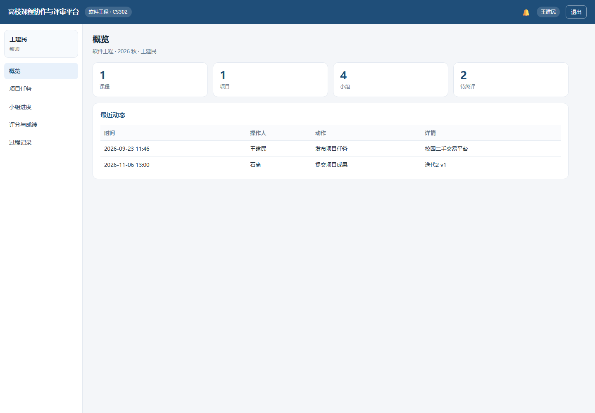
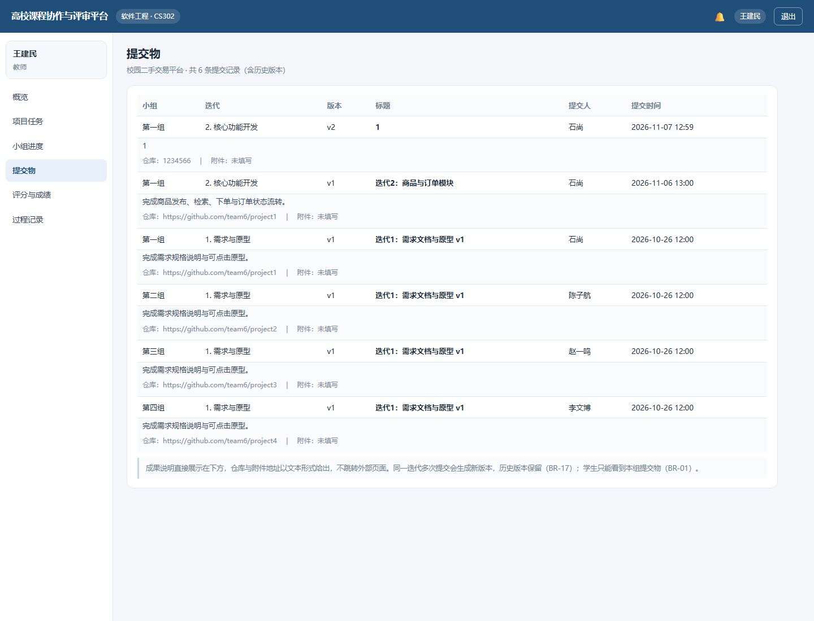
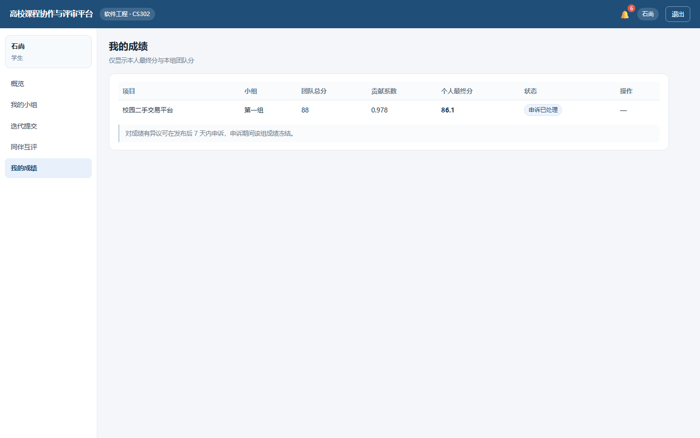

# 高校课程协作与评审平台

软件工程课程实验 · 第六组 · 系统实现阶段

> 仓库地址：<https://github.com/shi345018-beep/course-collab-platform>



## 界面预览

| 教师 · 提交物 | 学生 · 成绩与申诉 |
|---|---|
|  |  |

## 快速开始

```bash
node seed.js     # 首次运行：生成演示数据
node server.js   # 启动服务
```

或直接双击 `start.bat`。

浏览器打开 <http://localhost:8099>。

## 演示账号

| 角色 | 账号 | 密码 |
|---|---|---|
| 教师 | teacher | 123456 |
| 助教 | ta | 123456 |
| 学生（组长） | student1 | 123456 |
| 学生 | student2 | 123456 |

## 技术栈

- Node.js 22+，**零第三方依赖**
- 数据存储：本地 JSON 文件（原子写入）
- 前端：原生 HTML / CSS / JavaScript

## 目录

```
server.js        HTTP 服务与静态资源
seed.js          演示数据生成
lib/store.js     数据层（JSON 持久化）
lib/auth.js      认证（scrypt + token）
lib/activity.js  通知与过程记录
lib/grades.js    评分引擎
lib/api.js       REST 接口与业务规则
public/          前端页面
docs/            环境清单、系统说明、架构与测试
```
