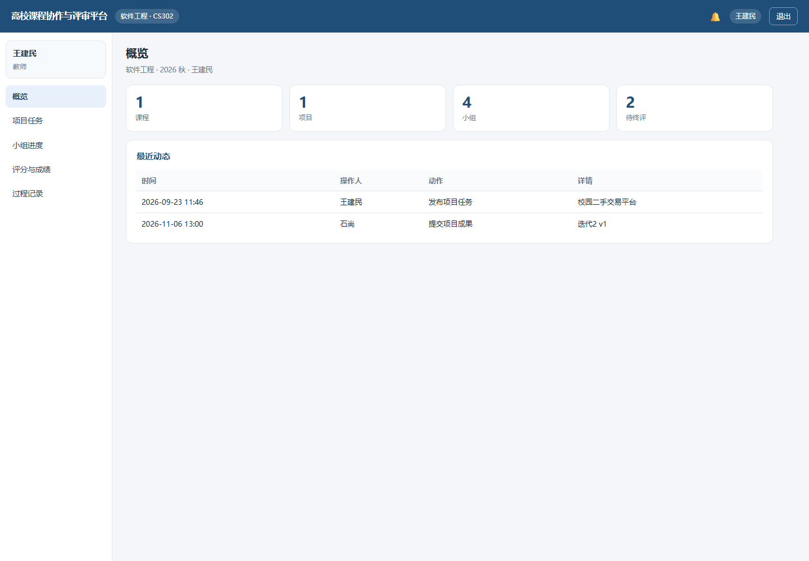
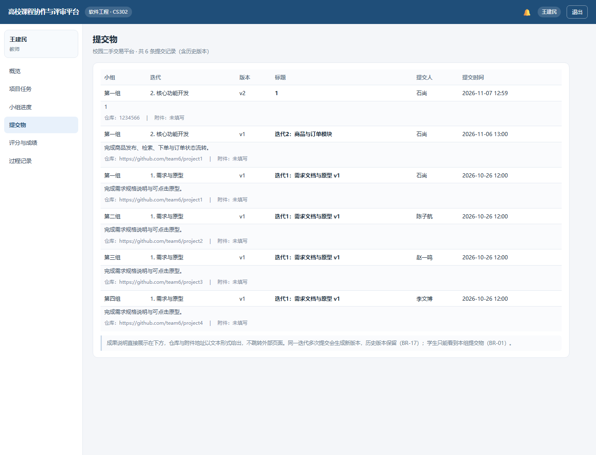
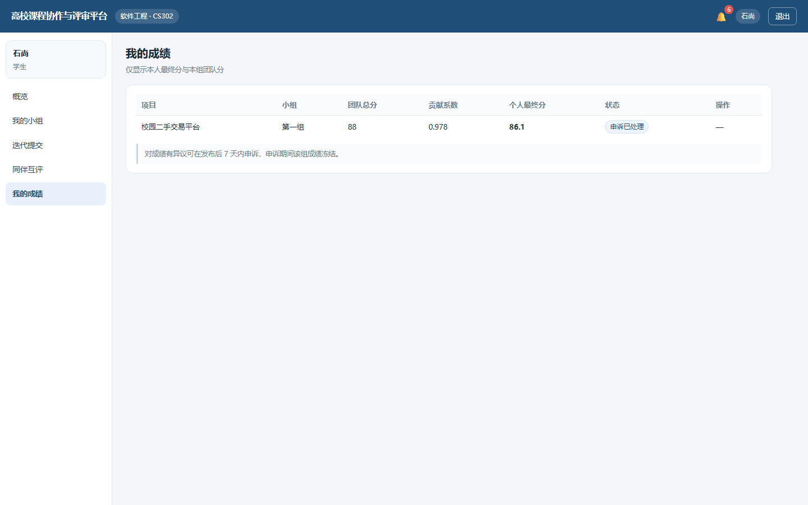

# 高校课程协作与评审平台

软件工程课程实验 · 第六组 · 系统实现阶段

> 仓库地址：<https://github.com/shi345018-beep/course-collab-platform>



## 界面预览

| 教师 · 提交物 | 学生 · 成绩与申诉 |
|---|---|
|  |  |

## 快速开始

```bash
node seed.js     # 首次运行：生成演示数据
node server.js   # 启动服务
```

或直接双击 `start.bat`。

浏览器打开 <http://localhost:8099>。

## 演示账号

| 角色 | 账号 | 密码 |
|---|---|---|
| 教师 | teacher | 123456 |
| 助教 | ta | 123456 |
| 学生（组长） | student1 | 123456 |
| 学生 | student2 | 123456 |

## 技术栈

- Node.js 22+，**零第三方依赖**
- 数据存储：本地 JSON 文件（原子写入）
- 前端：原生 HTML / CSS / JavaScript

## 架构（v2）

v2 采用模块化单体，依赖方向固定为 `http → controller → service → domain/repository`。
架构约束、决策记录与迁移计划见 `docs/architecture.md`、`docs/adr/`、`docs/rebuild-plan.md`。

```
src/
  app.js            组合根
  config.js         运行配置
  http/             服务、路由、错误
  modules/          auth、courses、projects、teams、submissions、
                    reviews、checks、grades、activity、dashboard
  domain/           评分纯函数
  infra/            数据适配、token、审计
  shared/           跨层共享错误类型
```

## 目录

```
server.js         启动入口（加载 src/server.js）
src/              v2 业务代码
public/           前端页面与 api-client
test/             20 项接口回归
tools/            架构约束检查
docs/             环境清单、系统说明、架构、ADR、测试
lib/              v1 历史实现（只读参考，不再被入口加载）
```

## 质量门禁

```bash
node tools/arch-check.js   # 依赖方向、零依赖、前端调用点
node test/api-test.js      # 20 项接口回归
```
